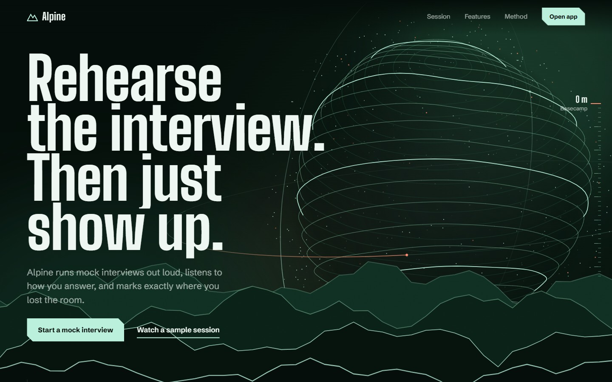
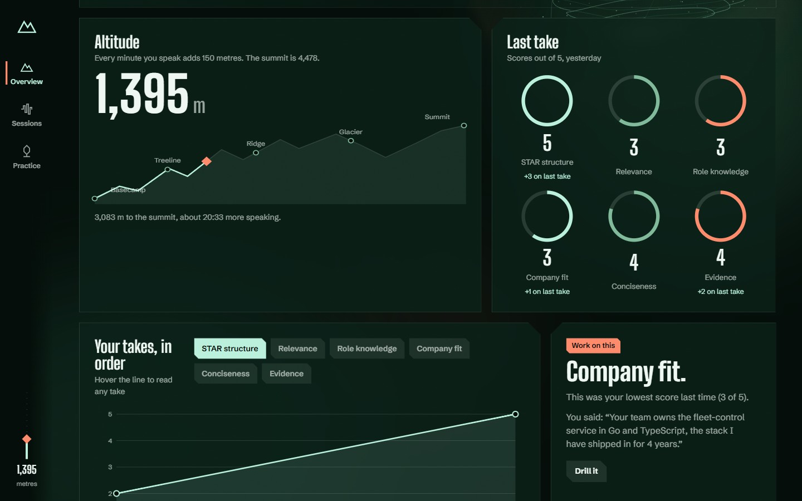
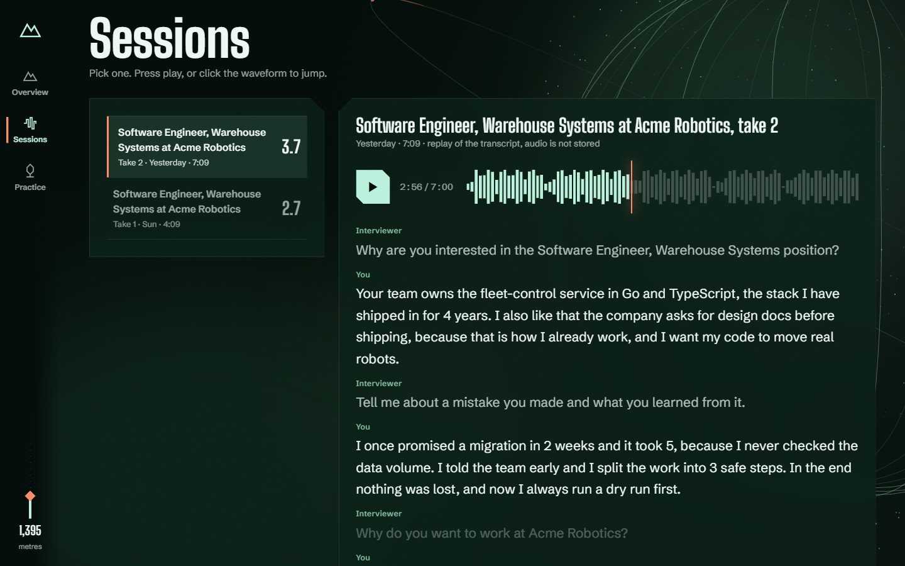
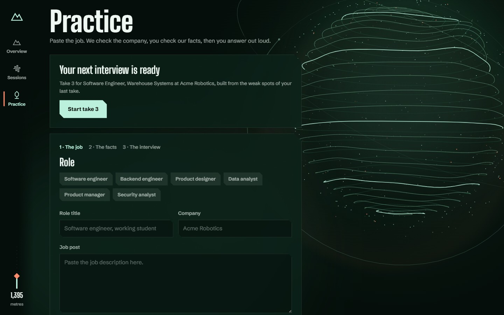
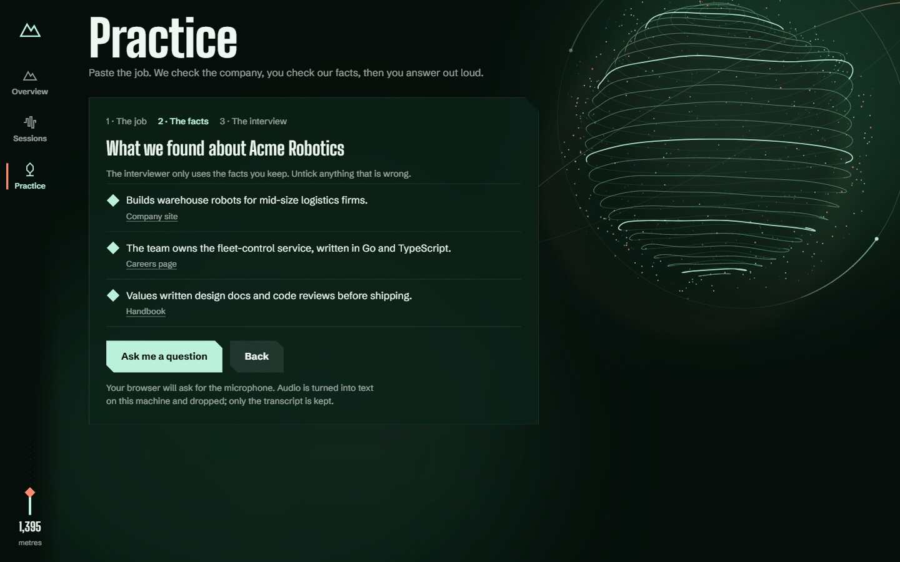
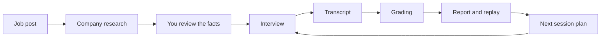

<div align="center">


# Alpine

**Rehearse the interview. Then just show up.**

Practice a job interview out loud with an AI interviewer, get scores that quote what you said,<br>
and a next interview aimed at your weakest answers.


[](LICENSE)

[Features](#features) · [How it works](#how-it-works) · [Quick start](#quick-start) · [Project status](#project-status) · [Contributing](CONTRIBUTING.md)

</div>



## Features

- **Questions built for the job.** Paste a job post and get a five-question session for that role.
- **Company facts with sources.** Every fact links to where it came from. Untick anything wrong, and only the facts you keep reach the interviewer.
- **A spoken interview.** Whisper hears you, Kokoro speaks, and the LLM writes at most one follow-up per question. You can also type your answers.
- **Scores you can check.** Six dimensions, graded three times and taken at the median, each backed by a quote from your own answer.
- **Replay and report.** Step through the transcript on a timeline, see your filler words and speaking time, and download the report as a PDF.
- **A next interview that adapts.** Your two weakest dimensions shape the next session: three questions on them, one repeated anchor and one new angle.
- **Progress you can see.** Track scores across takes and climb toward a 4,478 m summit, 150 m for every minute you speak.

## Screenshots

<table>
  <tr>
    <td width="50%"></td>
    <td width="50%"></td>
  </tr>
  <tr>
    <td align="center"><b>Overview</b>: altitude, scores and progress</td>
    <td align="center"><b>Sessions</b>: replay any take from its transcript</td>
  </tr>
  <tr>
    <td width="50%"></td>
    <td width="50%"></td>
  </tr>
  <tr>
    <td align="center"><b>Practice</b>: start from a job post</td>
    <td align="center"><b>Facts</b>: check what the interviewer will use</td>
  </tr>
</table>

<sub>Screenshots use sample sessions for Acme Robotics, the fictional demo company, scored by the rule-based demo grader.</sub>

## How it works



| Step | What happens | Endpoint |
| --- | --- | --- |
| **Research** | Finds company facts, each with its source | `POST /api/research` |
| **Review** | You untick anything wrong. Only the facts you keep reach the interviewer | |
| **Interview** | Five questions built for this job, with the text transcript saved to the session | `POST /api/session` |
| **Report** | Six dimensions: STAR, relevance, role knowledge, company fit, conciseness and evidence. Three runs, the median, and a quote for every score | `POST /api/grade` |
| **Next interview** | Three questions on your two weakest dimensions, one repeated anchor, one new angle | `POST /api/next` |
| **Progress** | Compares your graded sessions on the same dimensions | `GET /api/progress/{job}` |

See the [backend README](backend/README.md) for the full API.

## Quick start

You need Python 3.13 and Node 20.19+ or 22.12+. The commands are for Windows PowerShell, because the root npm scripts call `.venv\Scripts\python`.

### Try it without a GPU or API key

```powershell
cd backend
python -m venv .venv
.venv\Scripts\pip install -r requirements.txt
Copy-Item .env.example .env
cd ..
npm install
npm --prefix frontend install
```

Set `VOICE_ENABLED=false` in `backend/.env`, then run `npm run dev` and open http://localhost:5173.

Use **Acme Robotics** as the company and type your answers. Research comes from a cache and a simple rule-based grader gives the scores, so they are only rough. With `LLM_API_KEY` empty, the grader and research send no LLM requests.

### Run the full voice interview

This also needs an NVIDIA GPU with CUDA for speech recognition.

```powershell
cd backend
python -m venv .venv
.venv\Scripts\pip install torch --index-url https://download.pytorch.org/whl/cu128
.venv\Scripts\pip install -r requirements.txt

# Kokoro voice files, about 340 MB, not in git
mkdir models
curl.exe -L -o models/kokoro-v1.0.onnx https://github.com/thewh1teagle/kokoro-onnx/releases/download/model-files-v1.0/kokoro-v1.0.onnx
curl.exe -L -o models/voices-v1.0.bin https://github.com/thewh1teagle/kokoro-onnx/releases/download/model-files-v1.0/voices-v1.0.bin

Copy-Item .env.example .env   # then set LLM_API_KEY
cd ..
npm install
npm --prefix frontend install
npm run dev
```

Open http://localhost:5173. The API docs are at http://localhost:8100/docs.

The speech models load in the background on first start, which takes about a minute. Until `GET /api/voice/status` says they are ready, the interviewer's text appears as subtitles and you can type your answers.

## Tech stack

| Layer | Built with |
| --- | --- |
| Frontend | React 19, React Router 7, Vite 8, RNNoise noise suppression |
| API | FastAPI, Uvicorn, Pydantic, SQLite |
| Speech | Whisper large-v3 through faster-whisper (GPU), Kokoro through kokoro-onnx (CPU) |
| LLM | Any OpenAI-compatible endpoint. Several models are asked at once and the first valid answer wins |

## Repository layout

```text
Alpine/
├── backend/      FastAPI service used by the frontend
├── backend-ts/   Separate TypeScript API (Hono, Zod, Supabase), not connected to the frontend yet
├── frontend/     React app and landing page
├── video/        Product demo and promo videos (Remotion) and the scripts that rebuild them
├── docs/images/  README images
└── TODO.md       MVP checklist and status
```

## Privacy by design

- The camera is an optional local mirror, and nothing analyses it.
- Audio is turned into text and dropped. Only the transcript is stored.
- The interviewer says it is an AI in its first sentence and only uses facts that have a source.
- There is no face, emotion, confidence or personality analysis.
- You can export or delete everything stored for a job through the API.
- Scores are practice guidance, not a hiring decision.

## Project status

Alpine is an MVP and is not ready for real users yet.

- **Working today:** the full flow from job post to next session, using the frontend and `backend/`.
- **Open decision:** the repository has two backends. `backend-ts/` adds Supabase storage and a grader evaluation set but is not connected to the frontend. The team still has to pick one.
- **Before real users:** add authentication, choose an LLM provider with suitable data terms, and enforce transcript retention.

See [TODO.md](TODO.md) for the detailed checklist.

## Documentation

| Document | Covers |
| --- | --- |
| [Backend](backend/README.md) | FastAPI routes, settings and code map |
| [Frontend](frontend/README.md) | Scripts and code layout |
| [Videos](video/README.md) | Product demo and promo, and how to rebuild them |
| [TypeScript backend](backend-ts/README.md) | Setup, Supabase, demo mode, evaluation and known limits |
| [TypeScript API draft](backend-ts/docs/api.md) | Draft API contract |
| [Frontend wiring guide](backend-ts/docs/frontend.md) | How the frontend maps onto the TypeScript backend |

## Contributing

Contributions are welcome. Read the [contributing guide](CONTRIBUTING.md) first, and report security issues as described in [SECURITY.md](SECURITY.md).

## License

[MIT](LICENSE)
